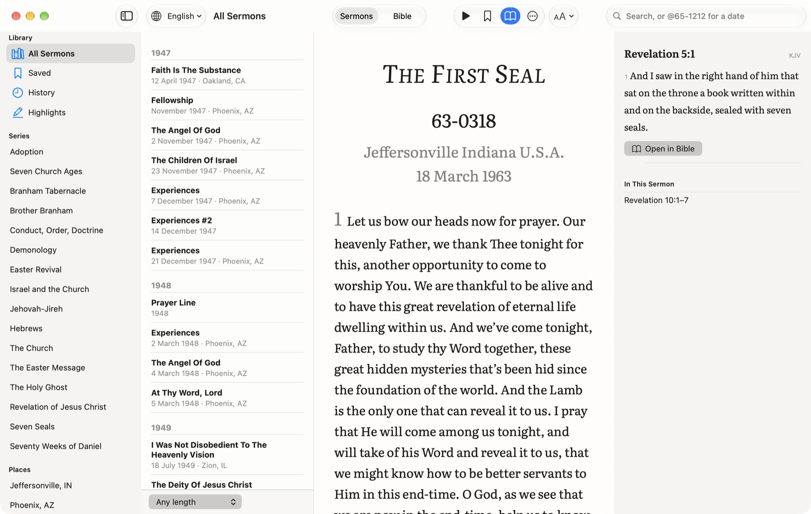

  

<h1 align="center">The Message for Mac</h1>

  William Branham’s sermons and the Bible, side by side. 
  Read them, hear them, study them, and put the words on the screen on Sunday.

  <a href="https://github.com/realbakari/the-message-mac/releases/latest/download/The-Message.zip"><strong>Download for Mac</strong></a>
  ·
  <a href="https://bakarimustafa.com/the-message/mac/">Website</a>
  ·
  <a href="https://github.com/realbakari/the-message-mac/releases">All releases</a>

## Install

1. Download [The-Message.zip](https://github.com/realbakari/the-message-mac/releases/latest/download/The-Message.zip).
2. Open the zip, then drag **The Message** to your Applications folder.
3. Open it from Applications.

The app is signed with Bakari Mustafa’s Developer ID and notarised by Apple, so it opens without warnings. It needs **macOS 26** or later.

## What it does

- **Sermons** set like the printed transcripts, in over 70 languages, with the recording, a sleep timer and offline reading.
- **The Bible** beside them: seven translations built in, the NET, NLT and ESV online, search, cross references and reading plans.
- **Study:** highlights in six colours you can name, notes and bookmarks, exported as Markdown, JSON or PDF.
- **For Sunday:** an order of service, a projector view, a speaker view with a countdown, and a lower third for livestreams.

## Privacy

No account, no analytics and no advertising. Your highlights, notes and history stay on your Mac.

## Help

Email [bakari@bakarimustafa.com](mailto:bakari@bakarimustafa.com) or [open an issue](https://github.com/realbakari/the-message-mac/issues).

This repository holds the releases. The sermons come from [The Message API](https://bakarimustafa.com/api-docs/).
